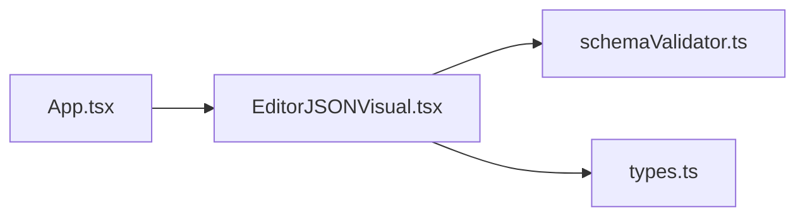

# editor-json-visual

**English** · [Português (Brasil)](README.md)

    

## What it is

**A visual JSON editor with schema validation**: an interface to **view, edit and validate** JSON documents against a **JSON schema**. It is a web app (SPA) built with React + TypeScript on Vite that runs entirely in the browser.

## Status

A working web app (prototype), with 34 unit tests passing and a confirmed production build.

## Features

- **JSON viewing and editing** in a navigable editor.
- **JSON-schema validation** (`schemaValidator.ts`): the app itself validates the document against the given schema.
- **React + TypeScript UI**, with themes and typed components.
- **Runs 100% offline/in the browser** — no backend.

## Architecture

A React SPA assembled by Vite. `EditorJSONVisual.tsx` is the main component; `schemaValidator.ts` encapsulates the validation logic; `types.ts` defines the domain types.



## Stack

- React 18.3, ReactDOM 18.3
- TypeScript ~5.6
- Vite 5.4 (build/dev), Vitest 2.1 + jsdom (tests)
- No runtime dependencies beyond React

## Repository layout

```
editor-json-visual/
├── src/
│   ├── App.tsx · main.tsx
│   ├── EditorJSONVisual.tsx   # main component
│   ├── schemaValidator.ts     # JSON-schema validation
│   └── types.ts               # domain types
├── test/schemaValidator.test.ts
├── index.html · vite.config.ts · tsconfig.json
└── package.json
```

## Prerequisites and installation

Node.js ≥ 18 and npm.

```bash
npm install
```

## How to run

```bash
npm run dev        # dev server (Vite)
npm run build      # production build (tsc + vite build)
npm run preview    # serve the build locally
```

## Tests and quality

Real commands (verified by the agent):

```bash
npm test
# Test Files  1 passed (1)
# Tests       34 passed (34)

npm run build
# ✓ built in ~1s (Vite 5.4.21)
```

## Technical decisions and trade-offs

- **Client-side validation in plain JS**: no backend or data upload.
- **React + TS + Vite**: a modern, typed stack; lean build (~151 kB bundle, ~48 kB gzip).

## Known limitations

- Validation covers what the schema supports (own validator, not a full JSON-Schema library).
- No document persistence (browser-session only).

## Development process

An individual project by Kelvin Oliveira, built with orchestrated AI agents and reviewed by the author. The validation logic and the review are the author's.

## License and author

MIT — Copyright (c) 2026 Kelvin Oliveira.

**Author**: [Kelvin Oliveira](https://github.com/KelvinOliveiraCode) · [Portfolio](https://kelvinoliveiracode.github.io/portfolio/)
