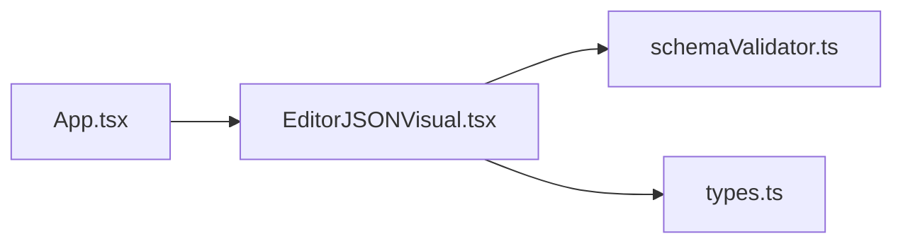

# editor-json-visual

[English](README.en.md) · **Português (Brasil)**

    

## O que é

**Editor visual de JSON com validação de schema**: interface para **visualizar, editar e validar** documentos JSON contra um **schema JSON** (JSON Schema). É uma aplicação web (SPA) em React + TypeScript construída com Vite, que roda 100% no navegador.

## Status

Aplicação web funcional (protótipo), com 34 testes de unidade passando e build de produção confirmado.

## Funcionalidades

- **Visualização e edição de JSON** em editor navegável.
- **Validação contra schema JSON** (`schemaValidator.ts`): a própria aplicação valida o documento contra o schema informado.
- **Interface em React + TypeScript**, com temas e componentes tipados.
- **Roda 100% offline/no navegador** — sem backend.

## Arquitetura

SPA em React montada pelo Vite. `EditorJSONVisual.tsx` é o componente principal; `schemaValidator.ts` encapsula a lógica de validação; `types.ts` define os tipos do domínio.



## Stack

- React 18.3, ReactDOM 18.3
- TypeScript ~5.6
- Vite 5.4 (build/dev), Vitest 2.1 + jsdom (testes)
- Sem dependências de runtime além de React

## Estrutura do repositório

```
editor-json-visual/
├── src/
│   ├── App.tsx · main.tsx
│   ├── EditorJSONVisual.tsx   # componente principal
│   ├── schemaValidator.ts     # validação contra schema JSON
│   └── types.ts               # tipos do domínio
├── test/schemaValidator.test.ts
├── index.html · vite.config.ts · tsconfig.json
└── package.json
```

## Pré-requisitos e instalação

Node.js ≥ 18 e npm.

```bash
npm install
```

## Como executar

```bash
npm run dev        # dev server (Vite)
npm run build      # build de produção (tsc + vite build)
npm run preview    # serve o build localmente
```

## Testes e qualidade

Comandos reais (verificados pelo agente):

```bash
npm test
# Test Files  1 passed (1)
# Tests       34 passed (34)

npm run build
# ✓ built in ~1s (Vite 5.4.21)
```

## Decisões técnicas e trade-offs

- **JavaScript puro p/ validação no cliente**: sem backend nem upload dos dados.
- **React + TS + Vite**: pilha moderna e tipada; build enxuto (bundle ~151 kB, ~48 kB gzip).

## Limitações conhecidas

- Validação cobre o que o schema suporta (validador próprio, não uma lib JSON Schema completa).
- Sem persistência dos documentos (apenas na sessão do navegador).

## Processo de desenvolvimento

Projeto individual de Kelvin Oliveira, construído com agentes de IA orquestrados e revisado pelo autor. A lógica de validação e a revisão são do autor.

## Licença e autor

MIT — Copyright (c) 2026 Kelvin Oliveira.

**Autor**: [Kelvin Oliveira](https://github.com/KelvinOliveiraCode) · [Portfólio](https://kelvinoliveiracode.github.io/portfolio/)
